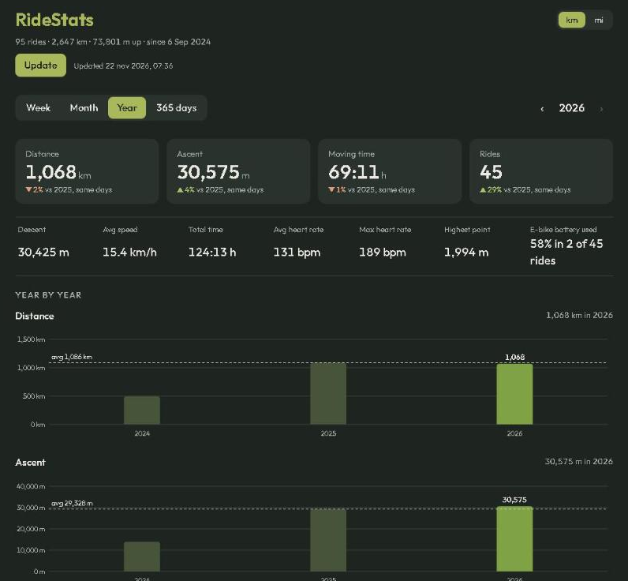
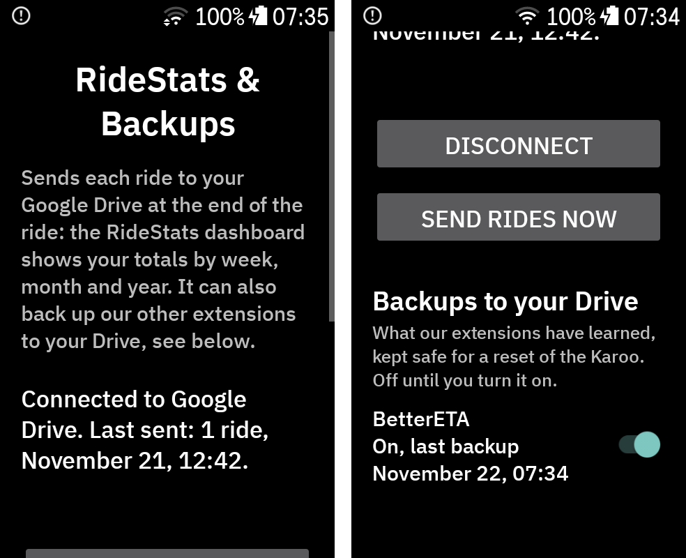

<picture>
  <source media="(prefers-color-scheme: dark)" srcset="https://gist.githubusercontent.com/anpaiss/78cf5eb76ad50594402b9778008a00a8/raw/RideStats-card-dark.svg">
  
</picture>

# RideStats & Backups

> **Version 1.0**: install the APK from the [latest release](../../releases/latest/download/RideStats.apk).

Two things for the Hammerhead Karoo, both stored in **your own Google Drive**:

- **RideStats**: every ride goes to your Drive when it ends, and the [RideStats dashboard](https://lagorai.bike/ridestats/) on your phone or PC shows your kilometres, climbing and time by week, month and year.
- **Backups**: a copy of what our other extensions have learned, to restore it after a reset of the Karoo.

## RideStats

### What it does

- **At the end of each ride** the extension reads the ride's FIT file on the Karoo and sends a short summary of it to a **RideStats** folder in your Google Drive, one small file per ride.
- **The first time** you connect, it sends every ride already on the Karoo, so the dashboard starts with your history.
- **No WiFi at the end of the ride?** It tries again as soon as a network comes back (WiFi, or the Karoo's link to the phone), and every 15 minutes until it works. **SEND RIDES NOW** in the app does it by hand.
- Rides under 1 km or 5 minutes of moving time are skipped. A ride with an average speed under 3 km/h or over 30 km/h (a test, or the bike in the car) is sent but **unticked**: it does not count until you tick it.

### The dashboard

Open [lagorai.bike/ridestats](https://lagorai.bike/ridestats/) and sign in with the same Google account. It works on a phone and on a PC, and can be installed as an app from the browser.

- **Week, Month, Year, 365 days**, with arrows to go back in time.
- Distance, ascent, moving time and number of rides, each compared with **the same days of the year before**.
- Descent, average speed, total time, average and maximum heart rate, highest point, and the **e-bike battery used** (when [BoschData](https://github.com/anpaiss/BoschData) is running: battery at the start and at the end of each ride).
- **Charts** of each period against the ones before, with the average as a dashed line; stacked on a PC, one tab at a time on a phone.
- **The list of rides** of the period, each with a tick: untick a ride and it no longer counts. The choice is saved in the ride's file on your Drive, so it holds on every device.
- km or miles.

### What goes to your Drive

One small file per ride: start time, distance, ascent and descent, moving, timer and total time, maximum speed, average and maximum heart rate, average cadence, average temperature, highest point, e-bike battery at the start and at the end (with BoschData). **No GPS track and no position.**

## Backups

What some of our extensions learn takes many rides: BetterETA learns how fast you ride on each gradient and surface, and every road you have ridden. A reset of the Karoo deletes it. RideStats keeps a copy in a **RideStats Backups** folder of your Drive.

- One switch per extension, **off until you turn it on**.
- The copy is refreshed after each ride.
- **After a reset**: install the extension and RideStats again, connect Google, and RideStats offers to **RESTORE** what it finds on your Drive. Before anything is replaced you get a red WARNING that says what will be lost, and a CANCEL.
- An empty extension never overwrites a good copy: after a reset nothing is backed up until you choose to restore, or to back up this Karoo instead.
- Today: **BetterETA** (from version 1.1). Other extensions of the same author will appear in the list by themselves when they support it.
- A backup holds the extension's data as it is on the Karoo. For BetterETA that includes its memory of the roads you have ridden and the last GPS position it saw.

## Install

1. Download [`RideStats.apk`](../../releases/latest/download/RideStats.apk) from the latest release.
2. Sideload it onto the Karoo, for example with `adb install -r RideStats.apk`, or with the Hammerhead companion app.
3. Open **RideStats & Backups** from the Karoo's app list, with the Karoo on WiFi, and tap **CONNECT GOOGLE**. The Karoo shows a short code: on your phone go to `google.com/device`, enter the code and allow RideStats. The Karoo then sends your rides.
4. On your phone or PC open [lagorai.bike/ridestats](https://lagorai.bike/ridestats/) and sign in with the same account.
5. For backups: scroll down in the app and turn on the extensions you want.

It is not on the Hammerhead app store, but once installed it appears in the Karoo **Extensions** library with its description, screenshots and version, and the Karoo checks there for a newer release. The APK is release-signed: new versions install over the old one, the sign-in is kept.

## Your data

- RideStats asks Google for one permission only, `drive.file`: it can see and change **only the files it created**, never the rest of your Drive.
- There is no RideStats server: the data goes only between your Karoo, your browser and your Google Drive, never to me or anyone else. Details in the [privacy page](https://lagorai.bike/privacy/#ridestats).
- To stop: **DISCONNECT** in the app, remove RideStats from your Google account's third-party access, and delete the RideStats folders from your Drive if you want the data gone.

## Is it safe?

- The code is all here, open source.
- `RideStats.apk` 1.0 on [VirusTotal](https://www.virustotal.com/gui/file/43d6d39088a3426e96196bd811fa384f8ca2238ccb8731e2c9c99300ec30c6f5): none of the 66 engines flag it.
- Its SHA-256 is `43d6d39088a3426e96196bd811fa384f8ca2238ccb8731e2c9c99300ec30c6f5`; compare it with the file you downloaded (`certutil -hashfile RideStats.apk SHA256` on Windows, `sha256sum RideStats.apk` elsewhere).
- The APK is built by GitHub Actions from the tagged source, with a signed provenance; each release's notes give its SHA-256 and link its VirusTotal report. Check the provenance with `gh attestation verify RideStats.apk -R anpaiss/RideStats`.
- Permissions: internet and network state (Google sign-in and Drive), storage (to read the ride files in `/sdcard/FitFiles`), and a permission shared only with apps signed by the same author, for the backups.
- The Google client secret in the APK is not a secret: for apps installed on a device Google does not treat it as confidential.

## Support

RideStats is free and open source, and will stay that way. If it made a ride better, you can [buy me a coffee on Ko-fi](https://ko-fi.com/anpaiss).

## License

MIT, see [LICENSE](LICENSE).

If you build on this code, or on its ideas, a mention is much appreciated: a link to this repository is enough.
